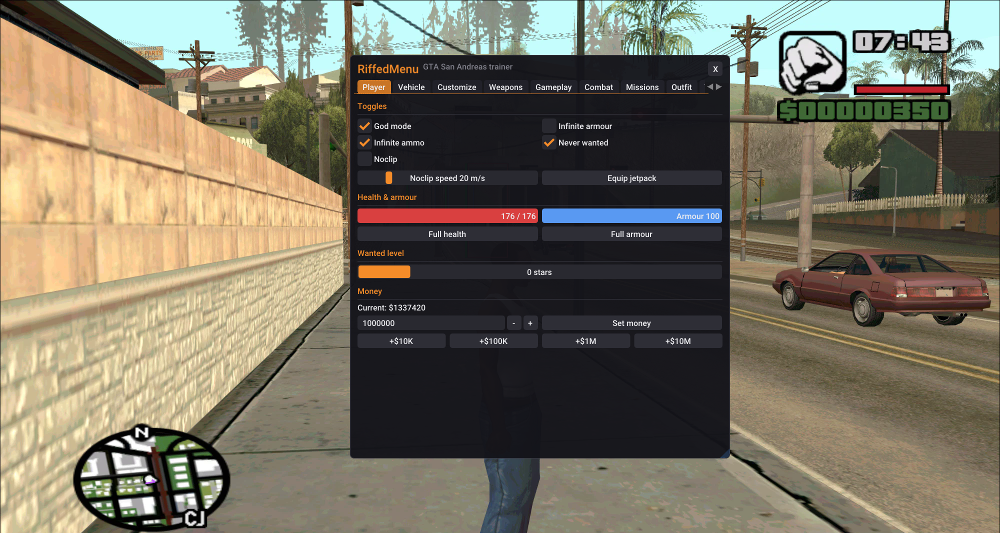
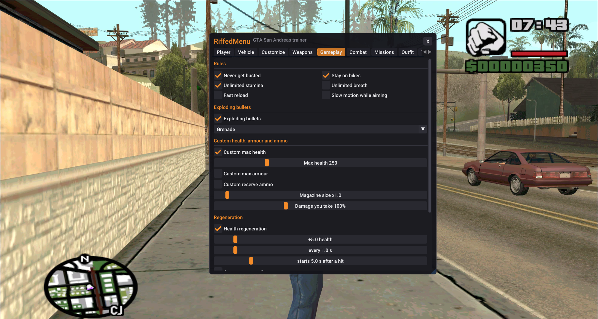
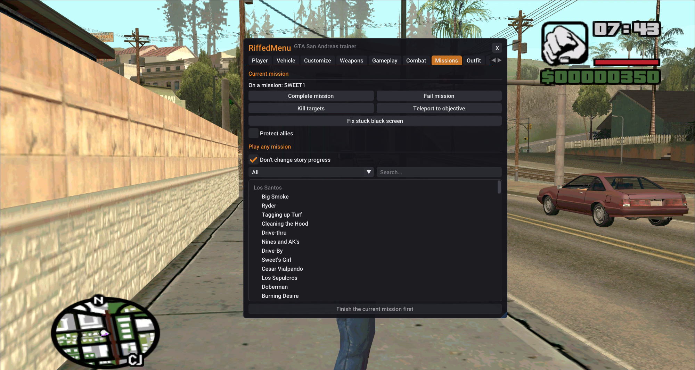

# RiffedMenu

An in-game trainer menu for **GTA: San Andreas** (the classic PC version). It loads as an `.asi` plugin.

Press **Insert** in game to open it.

## Preview








## Features

- **Player:** god mode, infinite armour and ammo, never wanted, wanted level, money, noclip, jetpack
- **Vehicle:** spawn anything, star your favorites and drag them into order, god mode, auto repair, flip, boost, infinite or always-on nitrous with no cooldown
- **Customize:** a pocket mod shop with paint, paintjobs and parts, plus a showroom camera
- **Weapons:** every weapon or quick packs, and a damage multiplier
- **Gameplay:** custom max health, armour and ammo, regeneration, lifesteal, exploding bullets, never busted, stay on bikes, unlimited stamina, free-look drive-by (hold right mouse in the driver's seat), no bullet spread, moving while aiming, sprinting with rifles and more
- **Combat:** a simple aimbot and 2D box wallhack, both off by default, with Advanced settings if you want them
- **Missions:** complete or fail the current mission, kill targets, teleport to the objective, or replay any mission without changing your story progress
- **Outfit:** clothes, haircuts, tattoos and skins, with a mirror camera
- **Teleport, World, Stats:** places and coordinates, time, weather, game speed, fat, muscle and skills
- **Weapon wheel:** hold a key, point with the mouse, release to equip
- **GPS:** the road route to your map marker, drawn on the minimap
- **Settings:** English or Polish, rebindable keys, multiple named configs with autoload, update notifications

## Supported game versions

| Version | Works |
|---|---|
| Steam (2014 re-release, `gta-sa.exe`) | ✅ tested |
| v1.0 US (`gta_sa.exe`) | ⚠️ should work, untested |
| Definitive Edition | ❌ |

On any other version the menu still opens, but shows a red warning and changes nothing in the game.

## Install

1. Install an ASI loader, if you don't have one yet. [Ultimate ASI Loader](https://github.com/ThirteenAG/Ultimate-ASI-Loader/releases) is a common choice; [SilentPatch](https://silent.gtagames.nl/) users usually already have one.
2. Download `RiffedMenu.asi` from [Releases](../../releases/latest).
3. Put it in the game folder, next to the game's `.exe`.
4. Start the game, load a save, and press **Insert**.

## Controls

| Key | Action |
|---|---|
| Insert | Open or close the menu |
| Tab (hold) | Weapon wheel |
| Right mouse (hold) | Aim: the aimbot locks on, if enabled |
| F7 | Toggle noclip |
| W A S D | Noclip: move where the camera looks |
| Space / Ctrl | Noclip: up / down |
| Shift | Noclip: faster |

You can change the Insert, Tab and F7 keys in Settings.

## Something not working?

RiffedMenu writes `RiffedMenu.log` in the game folder. Send that file to whoever is helping you.

If an item in the Outfit tab ever crashes your game, RiffedMenu disables that item on the next start. Your settings are in the `RiffedMenu` folder, which it creates by itself.

- **Menu doesn't appear:** check the log for `Game features ENABLED`. If it isn't there, your game version isn't supported.
- **Overlays:** RivaTuner/Afterburner and Discord overlays are fine, but if something acts up, try turning them off.

Single-player only. Don't use it with SA-MP or MTA (Combat features switch themselves off there). Anything you spawn or change gets saved if you save the game.

## Building from source

You need a MinGW cross compiler (`i686-w64-mingw32`), CMake and Ninja.

```bash
git clone --recursive https://github.com/RiffedStorm/RiffedMenu.git
cd RiffedMenu
cmake -S . -B build -G Ninja -DCMAKE_TOOLCHAIN_FILE=cmake/mingw-i686.cmake
cmake --build build        # -> build/RiffedMenu.asi
```

On Linux with Bottles, `build_and_run.sh` does everything in one step: it builds, copies the plugin into the game folder, starts the game and shows the logs. Put the repo inside the game folder, then run:

```bash
./build_and_run.sh          # options: --build-only, --no-tail, --clean
```

Optional environment variables: `BOTTLE=<name>` (default `Gry`) and `GAME_EXE=<file>`.

## How it works (short version)

Most features run through the game's own mission-script engine, the same way CLEO mods do. That means each game version only needs a few memory addresses. Those addresses live in `src/game.cpp`. The menu is drawn with [Dear ImGui](https://github.com/ocornut/imgui), and hooks are installed with [MinHook](https://github.com/TsudaKageyu/minhook).

| File | What's in it |
|---|---|
| `src/game.cpp` | Game access: version detection, addresses, script opcodes |
| `src/menu.cpp` | The menu UI |
| `src/features.cpp` | Toggles that run every frame (god mode, noclip…) |
| `src/combat.cpp` | Aimbot, wallhack, exploding bullets |
| `src/gps.cpp` | Route finding and minimap drawing |
| `src/wheel.cpp` | Weapon wheel |
| `src/config.cpp` | Saved settings |
| `src/i18n.cpp` | Polish text |
| `src/hooks.cpp` | Drawing, input blocking, Direct3D hooks |
| `src/data.h` | Lists of vehicles, weapons, teleports |
| `src/gamedata.cpp` | Reads car colours, tuning parts, clothes and skins from the game's own data files |

Text is drawn with the [Roboto](https://fonts.google.com/specimen/Roboto) font (Apache 2.0), built into the `.asi`.
